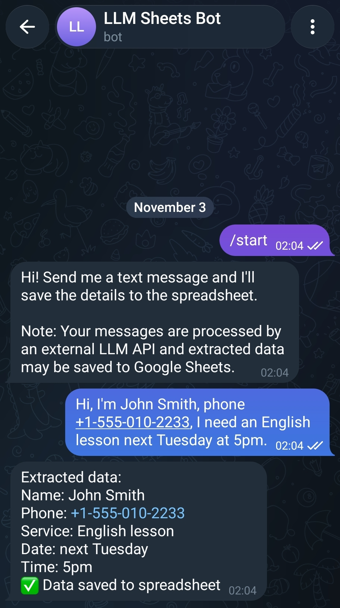
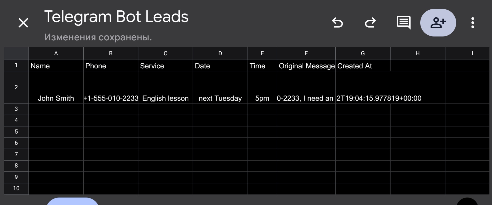

# Telegram LLM Sheets Bot

A demonstration Telegram bot that turns free-form text messages into structured
leads using an LLM, replies with the extracted fields, and appends the result to
Google Sheets.


## Status

This is a **demonstration prototype (Level D: Demo / Portfolio)**. It is not a
production system and is not intended for processing real personal data without
an additional security and legal review. All example data in this README is
fictional.

## Development approach

This project was developed under the direction of its owner, who acted as the
project lead and AI development orchestrator. The owner defined the requirements,
system constraints, architecture-level decisions, task breakdown, and acceptance
criteria; coordinated AI coding agents; reviewed their output; and directed
testing, security checks, and quality improvements.

AI agents assisted with code implementation, analysis, and testing under human
direction. The owner remained responsible for technical decisions, validation,
and final acceptance of the delivered work. AI-assisted reviews are part of the
development process and should not be considered independent third-party audits.

## What the bot does

- Receives text messages through Telegram long polling.
- Extracts `name`, `phone`, `service`, `date`, and `time` with an
  OpenAI-compatible LLM API using a strict JSON prompt.
- Validates the LLM response with a Pydantic model and strips Markdown code
  fences if the model adds them.
- Rejects empty extractions and asks the user for more details instead of
  writing a blank row.
- Appends each lead to a Google Sheet and creates the header row automatically
  when the sheet is empty.
- Deduplicates by `(chat_id, message_id)` to avoid writing the same update
  twice.
- Rejects messages longer than 2000 characters.
- Answers non-text messages with a short explanation.
- Sends a privacy notice on `/start` because messages are processed by a
  third-party LLM and extracted data is stored in Google Sheets.
- Runs as a non-root user inside Docker and shuts down gracefully on
  `SIGINT` / `SIGTERM`.

## Demo



A user sends a free-form message and the bot replies with the extracted fields and a save confirmation.



The same lead is appended as a new row in Google Sheets.

## Architecture

```text
Telegram user
    -> Telegram Bot API (long polling)
    -> handlers.py
        -> llm.py -> OpenAI-compatible API -> Pydantic Lead
        -> sheets.py (gspread, called via asyncio.to_thread) -> Google Sheets
```

- `python-telegram-bot` (v20.7) handles polling and message dispatch.
- `llm.py` sends a system prompt requesting strict JSON and maps provider
  failures to `LLMRequestError` / `LLMValidationError`.
- `sheets.py` opens the spreadsheet by ID with a Google Service Account and
  appends rows with `value_input_option="RAW"` to prevent formula injection.
- `config.py` loads settings from environment variables with
  `pydantic-settings`.

## Requirements

- Docker and Docker Compose v2 (`docker compose` command)
- A Telegram account and a bot created via [@BotFather](https://t.me/BotFather)
- An OpenRouter API key (free tier available) or any OpenAI-compatible endpoint
- A Google Cloud project with the Google Sheets API enabled

## Quick start

### 1. Create a Telegram bot

1. Open [@BotFather](https://t.me/BotFather) in Telegram.
2. Send `/newbot`, choose a display name and a username ending in `bot`.
3. Copy the token. It goes into `.env` as `TELEGRAM_BOT_TOKEN`.

### 2. Get an LLM API key

1. Sign up at [openrouter.ai](https://openrouter.ai).
2. Create a key at [openrouter.ai/keys](https://openrouter.ai/keys).
3. Use it as `LLM_API_KEY`. Free models work without billing.
4. If you use OpenRouter, also set `LLM_API_BASE=https://openrouter.ai/api/v1`
   and `LLM_MODEL` to a model ID from the OpenRouter catalog.

### 3. Set up Google Sheets

1. Create a project in the [Google Cloud Console](https://console.cloud.google.com/).
2. Enable the **Google Sheets API** under *APIs & Services -> Library*.
3. Create a Service Account under *IAM & Admin -> Service Accounts*.
4. Open the service account, go to *Keys -> Add Key -> Create new key -> JSON*,
   and download the key as `service-account.json`.
5. Create a spreadsheet at [sheets.google.com](https://sheets.google.com/) and
   copy the spreadsheet ID from its URL:
   `https://docs.google.com/spreadsheets/d/<SPREADSHEET_ID>/edit`.
6. Share the spreadsheet with the service account email as **Editor**.
   Without this step writes fail with permission errors.

### 4. Clone the repository

```bash
git clone https://github.com/alex-yorik/telegram-llm-sheets-bot.git
cd telegram-llm-sheets-bot
```

### 5. Configure environment variables

```bash
cp .env.example .env
```

Edit `.env` with your own values:

```env
TELEGRAM_BOT_TOKEN=0000000000:YOUR_BOT_TOKEN
LLM_API_KEY=sk-your-llm-key
LLM_API_BASE=https://api.openai.com/v1
LLM_MODEL=gpt-4o-mini
LLM_TIMEOUT_SECONDS=30
GOOGLE_SPREADSHEET_ID=your-spreadsheet-id
GOOGLE_SHEET_NAME=Sheet1
GOOGLE_APPLICATION_CREDENTIALS=/app/credentials/service-account.json
LOG_LEVEL=INFO
```

`GOOGLE_APPLICATION_CREDENTIALS` is the **in-container** path. Keep the default
`/app/credentials/service-account.json`; do not put a host path here.

### 6. Add the service account key

Place the downloaded key at:

```text
./credentials/service-account.json
```

The directory is mounted read-only into the container
(`./credentials:/app/credentials:ro`). The JSON key is gitignored and must never
be committed.

```bash
ls -la credentials/
# .gitkeep  service-account.json
```

### 7. Start the bot

```bash
docker compose up -d --build
```

### 8. Follow logs and manage the container

```bash
docker compose logs -f
docker compose logs -f --tail=30
docker compose ps
docker compose restart
docker compose down
```

After changing code or the Docker image:

```bash
docker compose down && docker compose up -d --build
```

Expected startup lines (values depend on your configuration):

```text
sheets - INFO - GoogleSheetsClient initialized (sheet=Sheet1)
__main__ - INFO - Bot started (polling).
```

Logs never include the spreadsheet ID, the service account file path, API keys,
Telegram `chat_id`/`user_id`, or message content.

## Environment variables

| Variable | Required | Default | Description |
|---|---|---|---|
| `TELEGRAM_BOT_TOKEN` | Yes | - | Bot token from @BotFather. |
| `LLM_API_KEY` | Yes | - | API key for the LLM provider. |
| `LLM_API_BASE` | No | `https://api.openai.com/v1` | Base URL of the OpenAI-compatible API. For OpenRouter use `https://openrouter.ai/api/v1`. |
| `LLM_MODEL` | No | `gpt-4o-mini` | Model name or OpenRouter model ID. |
| `LLM_TIMEOUT_SECONDS` | No | `30` | LLM request timeout in seconds. |
| `GOOGLE_SPREADSHEET_ID` | Yes | - | Spreadsheet ID from the Google Sheets URL. |
| `GOOGLE_SHEET_NAME` | No | `Sheet1` | Worksheet name. Falls back to the first sheet if not found. |
| `GOOGLE_APPLICATION_CREDENTIALS` | Yes | - | In-container path to the service account JSON. Keep `/app/credentials/service-account.json`. |
| `LOG_LEVEL` | No | `INFO` | Python log level (`DEBUG`, `INFO`, `WARNING`, ...). |

## Usage example

All names, phone numbers, and messages below are fictional demo data.

Input message:

```text
Hi, I'm John Smith, phone +1-555-010-2233, I need a haircut tomorrow at 10:00
```

Bot response:

```text
Extracted data:
Name: John Smith
Phone: +1-555-010-2233
Service: haircut
Date: tomorrow
Time: 10:00
✅ Data saved to spreadsheet
```

Missing fields are shown as `-`.

Example Google Sheets row:

| Name | Phone | Service | Date | Time | Original Message | Created At |
|---|---|---|---|---|---|---|
| John Smith | +1-555-010-2233 | haircut | tomorrow | 10:00 | Hi, I'm John Smith, phone +1-555-010-2233, I need a haircut tomorrow at 10:00 | 2026-09-07T06:15:52.448049+00:00 |

The header row is created automatically when the sheet is empty. Empty values
are stored as empty strings. Writes use `value_input_option="RAW"` to prevent
formula injection. `Created At` is a UTC ISO-8601 timestamp.

## Error handling

| Situation | What the user sees | What happens internally |
|---|---|---|
| Message longer than 2000 characters | `Message is too long (max 2000 characters). Please send a shorter message.` | Warning logged with `correlation_id` and length; no LLM call, no sheet write. |
| Duplicate `(chat_id, message_id)` | No reply | Duplicate is skipped and logged with `correlation_id` and `message_id` (`chat_id` is not logged). |
| LLM returns invalid JSON or fails validation | `Could not extract data. Please send a message with more details (name, phone, service, etc.).` | Error logged; no sheet write. |
| LLM network, API, or timeout error | `Processing error, try again later` | Error logged; no sheet write. |
| LLM returns an empty lead | `Could not extract meaningful data. Please send a message with more details (name, phone, service, etc.).` | Warning logged; no sheet write. |
| Unexpected error during extraction | `An error occurred` | Error type logged (no traceback); no sheet write. |
| Sheets unavailable at startup | Extracted data plus `⚠️ Data extracted but could not be saved to spreadsheet. Please try again later.` | Bot still starts; write is skipped with a warning. |
| Sheets write fails at message time | Extracted data plus `⚠️ Data extracted but could not be saved to spreadsheet. Please try again later.` | Exception logged; the bot keeps running. |
| Non-text message | `I only process text messages. Please send me a text description.` | No processing. |

The synchronous `gspread` calls run via `asyncio.to_thread()`, so polling is not
blocked.

## Testing and CI

The test suite uses `pytest`, `pytest-asyncio`, and `pytest-cov`. The measured
result below is **unit-test coverage**:

```text
81 passed, 0 skipped
TOTAL unit-test coverage: 99.33%
```

All unit tests isolate every external dependency with mocks: Telegram updates
are `MagicMock` objects, `llm.AsyncOpenAI` is patched, and `sheets.Credentials`,
`gspread.authorize`, and worksheets are patched. No real Telegram, LLM, or
Google Sheets request is made by the test suite.

This means coverage proves application logic, not that the real external APIs
are reachable or that the configured credentials and permissions are valid.
Availability, latency, quota limits, provider-side schema changes, and Google
API errors are outside the scope of this coverage.

Unit-test coverage by module:

| Module | Coverage |
|---|---|
| `config.py` | 100% |
| `handlers.py` | 100% |
| `llm.py` | 100% |
| `main.py` | 96% |
| `models.py` | 100% |
| `sheets.py` | 100% |

Run the checks locally:

```bash
python3.12 -m venv .venv
source .venv/bin/activate
pip install -r requirements-dev.txt

python -m pytest --cov=. --cov-report=term-missing
ruff check .
ruff format --check .
bandit -c pyproject.toml -r . -ll -q
```

CI consists of two GitHub Actions workflows:

- `.github/workflows/ci.yml`: jobs `test`, `lint`, and `docker-build`.
- `.github/workflows/quality-gates.yml`: jobs `secrets-scan`, `pip-audit`,
  `bandit`, `coverage-gate`, and `modularity`.

Protection for `main` is enforced by the active GitHub Ruleset `Main`
(`26415946`), not by classic branch protection. The ruleset requires all 8
status checks before a merge: `test (3.12)`, `lint`, `docker-build`,
`modularity`, `coverage-gate`, `secrets-scan`, `bandit`, and `pip-audit`.
`bandit` and `pip-audit` are therefore blocking checks.

The coverage gate fails below 80%. The measured unit-test suite is at 99.33%.
The mocked unit tests are a fast, mandatory CI step and stay unchanged.

Real integrations are verified by a **manual** smoke test that uses dedicated
test credentials. It is deliberately excluded from public CI so that no secrets
are exposed. See
[docs/integration-smoke-test.md](docs/integration-smoke-test.md) for
preparation, step-by-step commands, expected results, and cleanup.

A passing coverage gate does not prove that Telegram, the LLM provider, or
Google Sheets are currently reachable. If the smoke test was not executed, the
status of the real integrations is `NOT VERIFIED`.

## Security and privacy notes

See [SECURITY.md](SECURITY.md) for the vulnerability reporting policy and the
full security notes. Key points:

- Secrets are provided through environment variables. `.env` and
  `credentials/*.json` are gitignored and excluded from the Docker build context.
- The service account key is mounted read-only into the container.
- The container runs as a non-root user (`uid 1000`).
- Logs record metadata only (`correlation_id`, message length, processing stage,
  and outcome). Telegram `chat_id`/`user_id`, message text, extracted personal
  data, spreadsheet ID, service account file path, and API keys are never written
  to logs. `correlation_id` is a random per-request UUID and is safe for support
  diagnostics.
- Message content is sent to a third-party LLM provider, and extracted data is
  stored in Google Sheets. Do not use this bot with real personal data without
  reviewing provider policies, obtaining user consent, and checking applicable
  privacy law.
- Google Sheets writes use `value_input_option="RAW"` to prevent formula
  injection.
- Deduplication uses a bounded in-memory deque (last 1000 entries) and is lost
  on restart.
- There is no per-user rate limiting and no GDPR/HIPAA compliance out of the
  box.

## Known limitations

See [TECH_DEBT.md](TECH_DEBT.md) for the full list with severity and rationale.
The main limitations are:

- Deduplication uses a bounded in-memory deque of `(chat_id, message_id)` (last
  1000 entries) and resets when the bot restarts.
- There is no per-user rate limiting, so a single user can generate unlimited
  LLM API calls.
- Google Sheets writes have no retry or queue, so transient API failures can
  lose a lead.
- Only a single worksheet is supported; there is no rotation or archival.
- There is no encryption at rest beyond what Google Sheets provides, and no
  GDPR/HIPAA tooling.

## Future improvements

If this project evolves beyond a demo, the planned work is:

- Add a persistent store (SQLite or PostgreSQL) for deduplication and leads.
- Add per-user rate limiting with configurable quotas.
- Add retry with exponential backoff for LLM and Sheets API calls.
- Add an application-level liveness probe and a `/health` endpoint.
- Add metrics and monitoring for LLM calls, sheet writes, and errors.
- Add a consent flow and data export/deletion endpoints for privacy compliance.
- Add webhook mode, multi-language support, and admin commands.

## Project structure

```text
.
├── main.py                    # Entry point: logging, Application setup, polling, graceful shutdown
├── handlers.py                # /start, text and unsupported-message handlers; dedup and limits
├── llm.py                     # LLM extraction, JSON parsing, Lead validation
├── sheets.py                  # GoogleSheetsClient, header creation, append_lead
├── models.py                  # Pydantic Lead model
├── config.py                  # pydantic-settings configuration
├── requirements.txt           # Runtime dependencies
├── requirements-dev.txt       # Development, testing, and CI tools
├── pyproject.toml             # pytest, coverage, ruff, and bandit configuration
├── Dockerfile                 # python:3.12-slim, non-root user, `python main.py`
├── docker-compose.yml         # bot service, env file, read-only credentials mount, data volume
├── .env.example               # Environment variable template (placeholders only)
├── .dockerignore              # Excludes secrets, tests, docs, and tooling from the image
├── .gitignore                 # Excludes secrets, local data, and caches
├── .pre-commit-config.yaml    # ruff and bandit hooks
├── .gitleaksignore            # Documented false-positive fingerprints
├── SECURITY.md                # Security policy and limitations
├── TECH_DEBT.md               # Known limitations and future improvements
├── LICENSE                    # All rights reserved
├── credentials/
│   └── .gitkeep
├── docs/
│   ├── integration-smoke-test.md  # Manual smoke test for real external APIs
│   ├── images/                # README screenshots
│   └── reports/               # AI-assisted engineering reports (audit, phases, CI, README check)
└── tests/
    ├── __init__.py
    ├── conftest.py
    ├── test_config.py
    ├── test_handlers.py
    ├── test_llm.py
    ├── test_logging_privacy.py
    ├── test_main.py
    ├── test_models.py
    └── test_sheets.py
```

## License

All rights reserved. See [LICENSE](LICENSE) for the full terms.
